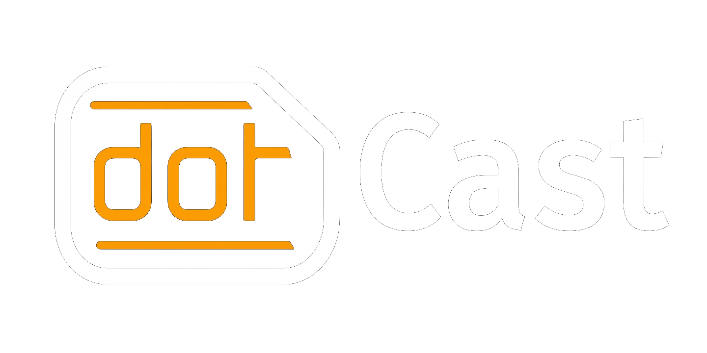

**Digital signage para Android TV, Android, Windows e browser.** O DotCast mostra fotos e vídeos em ecrãs da empresa. A box Android TV é o centro: guarda a playlist e os ficheiros, reproduz e serve um painel web. O telemóvel, o PC e o browser servem para enviar conteúdos e controlar a TV pela rede local.

## Transferências

As versões oficiais estão na página [Releases](https://github.com/Miguel7258/DotCast/releases). Transfere o ficheiro de que precisas:

| Ficheiro | Plataforma | Para quê |
| --- | --- | --- |
| `DotCast-TV.apk` | Android TV 8.0 ou superior (por exemplo, Xiaomi TV Box S) | A app da TV: o centro do DotCast. |
| `DotCast-Mobile.apk` | Android 8.0 ou superior | A app do telemóvel: enviar e controlar. |
| `DotCast-Setup.exe` | Windows 10/11 (64 bits) | O DotCast para PC: enviar, converter e guardar a cópia de segurança. |

Links diretos para a última versão: [Android TV](https://github.com/Miguel7258/DotCast/releases/latest/download/DotCast-TV.apk) · [Android](https://github.com/Miguel7258/DotCast/releases/latest/download/DotCast-Mobile.apk) · [Windows](https://github.com/Miguel7258/DotCast/releases/latest/download/DotCast-Setup.exe).

## As aplicações

### DotCast TV (Android TV): o centro
A app que fica ligada ao ecrã. Tudo passa por ela.
- Guarda a playlist e os ficheiros e reproduz fotos e vídeos em ciclo, com a duração das fotos e as transições que escolheres.
- Liga e desliga o ecrã num horário: fora dele o ecrã fica preto, mas a TV continua a receber envios e alterações.
- Mostra o código e o QR para ligar telemóveis, PCs e browsers, e só aceita aparelhos aprovados.
- Serve o painel web na rede local, em `http://<IP da TV>:7000`.
- Fica bloqueada até ser desbloqueada com a password de fábrica, no comando ou a partir da app do telemóvel.
- Em espera, mostra a galáxia Dotbright com o nome da empresa.

### DotCast Mobile (Android): enviar e controlar
- Liga-se à TV lendo o QR do ecrã, ou com o código e o endereço.
- Envia fotos e vídeos do telemóvel. Os vídeos que a TV não reproduz são convertidos no próprio telemóvel.
- Gere a playlist (ordem, duração, ativar e desativar, apagar) e controla a reprodução (anterior, pausa, seguinte).
- Aprova ou recusa os aparelhos que pedem para se ligar e muda as definições da TV: duração das fotos, transição e horário.
- Pode guardar uma cópia de segurança dos ficheiros e da playlist, para encher uma TV nova se a box avariar.
- Protegida por uma conta local, com desbloqueio por impressão digital opcional.

### DotCast para Windows: enviar, converter e guardar
- Janela própria e ícone junto ao relógio. Arranca com o Windows e fechar a janela não o termina.
- Envia fotos e vídeos para a TV. Converte os vídeos com o FFmpeg na máxima qualidade, sem perder resolução.
- Converte também os vídeos enviados de um browser que a TV não consegue reproduzir, e troca-os na playlist.
- Guarda uma cópia principal de toda a TV neste PC (`%LOCALAPPDATA%\DotCastMirror`). Se a TV for substituída, enche a TV nova com o mesmo conteúdo.
- Aprova aparelhos novos, abre o painel da TV e as definições da TV e procura atualizações nesta página.
- Importa o conteúdo das versões antigas do DotCast para PC.

### Painel web (qualquer browser)
- Abre-se em `http://<IP da TV>:7000`, num PC, Mac, iPhone ou tablet na mesma rede, sem instalar nada.
- Para ligar o browser, carrega em OK no comando da TV e escreve o código que aparece.
- Tem a playlist, os envios, o controlo, os aparelhos, o registo e as definições da TV.
- Os vídeos que o browser não consegue converter ficam «À espera de conversão» até o DotCast para Windows os converter.
- As fotos HEIC do iPhone não são aceites: no iPhone, escolhe **Definições › Câmara › Formatos › Mais compatível**.

## Instalação

1. **TV:** instala o `DotCast-TV.apk` na box (por ADB ou por um gestor de ficheiros). Abre a app e desbloqueia-a com a password de fábrica.
2. **Telemóvel:** instala o `DotCast-Mobile.apk`, cria a conta local e lê o QR da TV.
3. **PC (opcional, recomendado):** instala o `DotCast-Setup.exe` e liga-o à TV no separador **TV**.

Todos os aparelhos têm de estar na mesma rede local que a TV.

O Android pede autorização para instalar aplicações de fora da Play Store. Permite-a só para APKs descarregadas desta página. O Windows pode mostrar «O Windows protegeu o seu PC» (SmartScreen): escolhe **Mais informações › Executar mesmo assim**.

## Atualizações

- O DotCast para Windows procura versões novas nesta página e instala o instalador oficial.
- As apps Android atualizam-se instalando a APK nova por cima. A conta, as definições e a playlist mantêm-se.
- As APKs são assinadas com o certificado da Dotbright (SHA-256 `1060c8d81e61dcb85c2b19a8d899cd3d834ba32623561b7ff8263165bcb09470`). Uma APK com outra assinatura não é oficial.

## Suporte

Para comunicar um problema, contacta o administrador do DotCast na tua empresa. Indica a versão instalada, o aparelho e os passos que reproduzem o problema.

---

<strong>DotCast e DotBright são produtos reservados à DotBright e não se destinam à utilização pelo público geral.</strong>

